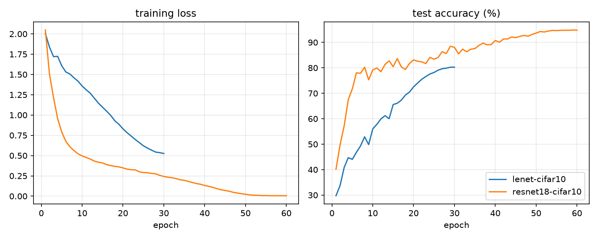

# vision-baselines

Reproducible PyTorch training pipelines for standard image-classification baselines.

The goal is a clean reference harness — deterministic seeding, standard augmentation, cosine learning-rate schedule, per-epoch CSV metrics, best-checkpoint saving — that new models and datasets can drop into without rewriting the training loop.

## Usage

```
pip install -r requirements.txt

python train.py --model lenet --epochs 30
python train.py --model resnet18 --epochs 60
python plot_curves.py      # learning curves for every run -> results/curves.png
```

Each run writes `results/<run-name>/metrics.csv` and `best.pt`.

## Models

- `lenet` — small LeNet-style CNN, a fast sanity-check baseline
- `resnet18` — torchvision ResNet-18 with a CIFAR-sized stem (3x3 conv, no initial max-pool — the ImageNet stem downsamples 32x32 inputs too aggressively)

## Results

CIFAR-10, seed 42, SGD with momentum 0.9, cosine schedule from lr 0.1, batch 128, on an Apple M3 Pro (MPS backend).

| Model | Epochs | Test accuracy (final epoch) | Best epoch |
|---|---|---|---|
| LeNet | 30 | 80.25% | 80.25% (epoch 30) |
| ResNet-18 | 60 | 94.79% | 94.87% (epoch 59) |

The table reports the final-epoch accuracy. The "best epoch" column is chosen by looking at the test set, so it is an optimistic number and is shown only for reference; a fair model-selection rule would use a separate validation split.



Notes from these runs:

- ResNet-18 test accuracy is noisy while the learning rate is high (between 75% and 84% from epoch 6 to epoch 20) and climbs steadily only as the cosine schedule decays: 88.1% at epoch 30, 93.7% at epoch 50, 94.8% at epoch 60.
- By epoch 60 the ResNet-18 training loss is 0.005, so the model fits the training set almost perfectly and more epochs alone are unlikely to add much; the usual next steps are stronger augmentation or regularization.
- Determinism check: an earlier ResNet-18 run on the same machine stopped after 10 epochs on 7 Aug 2026. The full run on 26 Nov 2026 reproduced all 10 of those epochs exactly (train loss and test accuracy to four decimals), even though it was paused and resumed every two minutes to keep the laptop cool.

## Roadmap

- [ ] mixed-precision training
- [ ] CIFAR-100 config
- [ ] fine-tuning pretrained backbones
